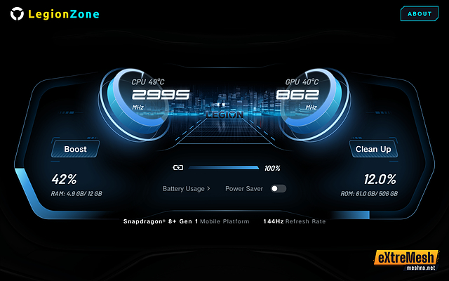
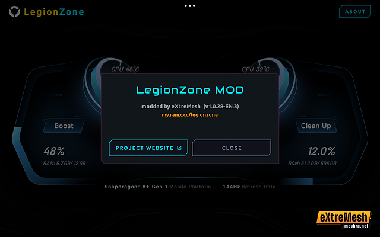

# LegionZoneMOD: App for Lenovo Android Tablets

An English, de-bloated mod of Lenovo's **Legion Zone** app for Legion Android tablets, by **eXtreMesh**.

-3ddc84)

---

## About

I love Lenovo products, especially their tablets. I recently bought a Legion Y700 Gen 4, even though I already owned a Y700 Gen 2, and I went for the Chinese version because it has more features.

One app on these Chinese Legion tablets that I use a lot is **Legion Zone**. It shows CPU, GPU, RAM and other details in real time and lets you tweak your tablet. The problem is that it's in Chinese and includes extra front ends, recommendations and apps that global users don't need.

So I made a modded version that's in English and has all of that stripped out.

## Screenshots

| Dashboard | About dialog |
|:---:|:---:|
|  |  |

## What was done

- Translated all Chinese text to English
- Removed the Chinese bloat inside the app and kept only the useful parts
- Added sounds when you interact with the app and its features
- Added an **About** button
- Made some UI tweaks and changes

## Requirements

- You need a **Lenovo tablet that originally shipped with the Legion Zone app**. The app integrates with the firmware (**ZUI / ZuxOS**), so it won't work on other devices.
- Tested and working on:
  - Lenovo Legion Y700 **Gen 2**
  - Lenovo Legion Y700 **Gen 3**
  - Lenovo Legion Y700 **Gen 4**
- It should work on other Legion tablets as well. If you've tested one, please let me know (see [Feedback](#feedback)).

## Installation

1. Uninstall the original **Legion Zone** app from your tablet.
2. Download the latest LegionZoneMOD APK from the [Releases](../../releases) page.
3. Install the APK on your tablet. You may need to allow installs from unknown sources.
4. Open **Legion Zone** and enjoy it in English.

## Security

You can check the VirusTotal scan of the APK here:
[VirusTotal report](https://www.virustotal.com/gui/file/d5cde0b79cf5bee21edfb0d5f5fb56bf318027133436dec6e82d747155abdc4b/detection)

## More info & video demo

The project page has full information and a video demo:
**[meshra.net/?p=328](https://meshra.net/?p=328)**

## Feedback

If you've tested this on your device and want to share how it went, you can reach me on [Discord](https://ramesh.my/discord).

I hope this app helps others as much as it has helped me.

## Disclaimer

This is an unofficial, community-made mod and is not affiliated with or endorsed by Lenovo. "Lenovo", "Legion" and "Legion Zone" are trademarks of Lenovo. Use it at your own risk.

---

Made by **[eXtreMesh](https://meshra.net/about)**
